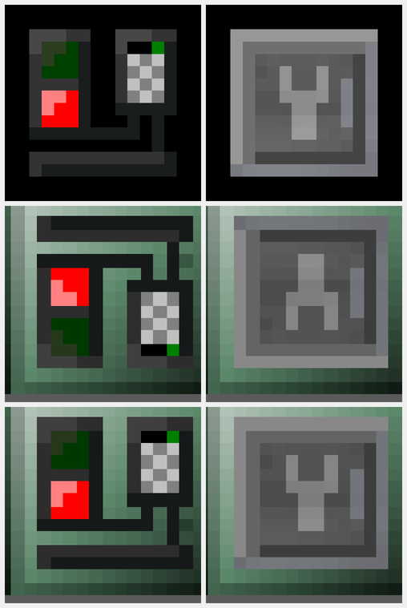
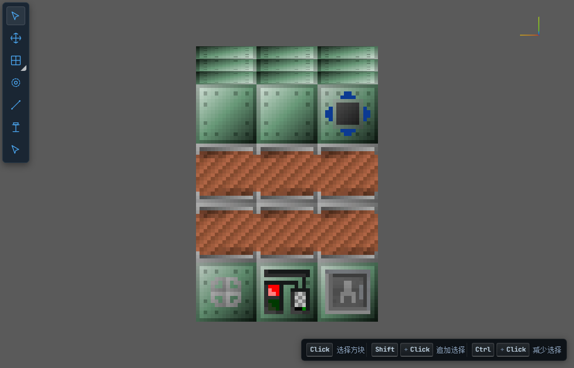
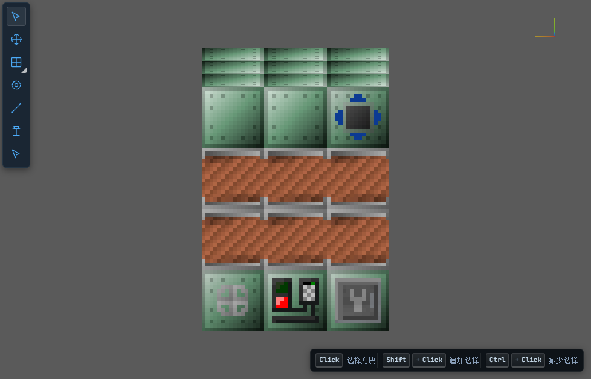
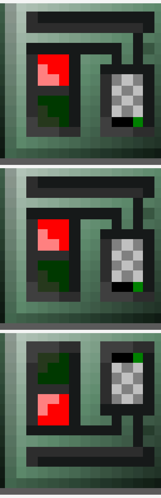

# 多方块产物纹理上下颠倒（UV 不正确）—— 根因与修复

> **BUG**：多方块导出产物（`mod/gtnh/run/client/sde_multiblock_exports/*.multiblock.json`）的**覆盖层图标上下颠倒**
> （扳手/控制器正面图标明显倒置）；底层纹理是否同样颠倒待查。
> **结论先行**：底层纹理**没有**颠倒；颠倒的是 GT 的 `.extFacing()` **图标覆盖层**，根因**不在** web 解码器、
> 也不在 UV 换算公式，而在**捕获期的渲染环境**——GT 是用「**玩家所在世界**」去查机器朝向的，而探针把方块建在
> `ProbeDummyWorld` 里，于是查不到机器 → 落入 GT 的「查不到朝向」回退分支，该分支对 NORTH 面做 `flipV`。
> **写范围**：只改 `client/multiblock/` 的 3 个文件（1 新增 + 2 处捕获入口）；`/sde export` 既有路径、
> web 解码器、协议、fixture 原件**一字未动**。

---

## 0. 结论（TL;DR）

| 项 | 结论 |
|----|------|
| **根因（一句话）** | GT5U 的贴图渲染 `GTRenderedTexture#getExtendedFacing(x,y,z)` 用 `GTMod.proxy.getThePlayer().getEntityWorld()`（= `mc.thePlayer.worldObj`，**玩家世界**）而不是被渲染世界的 `IBlockAccess` 去查机器朝向；探针捕获时方块在 `ProbeDummyWorld`、玩家在会话世界（`sde_pipeline_world`），探针坐标处查不到 TE → `alignment == null` → 走「查不到」回退分支 `getFlipped(side, null, icon)`（**NORTH flipV、EAST/DOWN flipU**）→ `.extFacing()` 覆盖层图标被镜像 |
| **底层纹理是否颠倒** | **否**。修复前后逐格比对：47 条配对条目里 39 条**逐字节一致**（含外壳、线圈、结构、标识），差异**只**落在覆盖层四边形上，且**恰好**是 `v → 1-v` |
| **影响面** | 所有带 `.extFacing()` 的 GT/GT++ 图标覆盖层，且只在其被画到的 **NORTH（flipV）/ EAST、DOWN（flipU）** 面上；当前 5 台验收产物中 4 台命中（19 个四边形）：`OVERLAY_MAINTENANCE`、`OVERLAY_FRONT_ELECTRIC_BLAST_FURNACE{,_GLOW,_ACTIVE,_ACTIVE_GLOW}`、`OVERLAY_FRONT_DISTILLATION_TOWER{,_GLOW,_ACTIVE,_ACTIVE_GLOW}`、`miscutils:iconsets/controllerFaces/quantumForceTransformer{,_Glow,Active,ActiveGlow}`、`…/advancedEBF{,_Glow,Active,ActiveGlow}`。`MTEBrickedBlastFurnace` 无覆盖层 → 不受影响 |
| **修复点** | 新增 `ProbeCaptureEnvironment`（捕获窗口内把**会话玩家的 `worldObj`** 指向被捕获世界，结束还原）；`VariantGeometryBakery#capture`、`StateGeometryCapture#capture` 两个入口改用它 |
| **`/sde export` 影响** | **零**（该路径捕获的方块本就在 `mc.theWorld` 里、玩家世界即被渲染世界，无需对齐；未引用新类，未改一行） |
| **web 解码器影响** | **零**（根因在捕获侧，`web/src/render/**` 未改；老产物 `web/e2e/fixtures/structuredata-exported-envelope.json` 在新代码下判定 34 个覆盖层四边形 / 0 个镜像，与修复前一致） |
| **验证** | 数据级门禁（修复前红 / 修复后绿）、修复前后差异面**只有** 19 个 `v→1-v` 覆盖层修正、`verify-expanded` 逐格 diff=0（5 台/35 组合/43749 格）、三次导出**逐字节幂等**、`vitest` 全绿（114/114）、`gradlew build` 通过、纹理原图 vs 渲染截图目视对照、**证伪实验**（临时改回 → 门禁变红、截图与修复前逐字节相同） |

---

## 1. 判据：什么叫「纹理上下颠倒」

三层证据口径，全部机器可读（脚本见 §4）：

1. **覆盖层手性 == 同面基础贴图手性**（主判据）。
   同一个轴对齐面上，`.extFacing()` 覆盖层四边形的面内 UV 手性（`du/dA`、`dv/dB` 的符号）必须与该面上
   基础贴图四边形一致；不一致 = 覆盖层相对底层纹理被镜像。
   *为什么这条判据成立*：基础贴图走 `TextureFactory.builder().addIcon(...)`（`useExtFacing=false`），
   GT 直接短路成 `ExtendedFacing.DEFAULT`，永远是「贴图 v=0 在块顶」；而游戏内覆盖层走的是
   `alignment.getExtendedFacing()`，对朝向规范（rotation=NORMAL、flip=NONE）的机器同样是「v=0 在块顶」。
2. **与纹理原图对照**：把 GT jar 里的 `assets/gregtech/textures/blocks/iconsets/*.png` 取出，与渲染截图
   目视比对（贴图第 0 行 = v=0 = 块顶，见 §5 图）。
3. **跨环境一致**：同一份代码在「主菜单态」与「会话世界内」两次捕获，覆盖层四边形必须逐字节一致。

---

## 2. 根因

### 2.1 GT 的朝向查询用的是「玩家的世界」（源码级）

GT5U `5.09.52.283`（`mod/gtnh/dependencies.gradle` 钉住的版本）`gregtech/common/render/GTRenderedTexture.java`：

```java
private ExtendedFacing getExtendedFacing(int x, int y, int z) {
    if (stdOrient || !useExtFacing) return ExtendedFacing.DEFAULT;   // ← 基础贴图在这里短路
    final EntityPlayer player = GTMod.proxy.getThePlayer();          // = Minecraft.thePlayer
    if (player == null) return ExtendedFacing.DEFAULT;               // ← 主菜单态走这里
    final World w = player.getEntityWorld();                         // ★ 玩家世界，不是渲染世界
    if (w == null) return ExtendedFacing.DEFAULT;
    final TileEntity te = w.getTileEntity(x, y, z);                  // ★ 在被渲染的坐标上查 TE
    IAlignment alignment = null;
    if (te instanceof IGregTechTileEntity) {
        final IMetaTileEntity meta = ((IGregTechTileEntity) te).getMetaTileEntity();
        if (meta instanceof IAlignmentProvider) alignment = ((IAlignmentProvider) meta).getAlignment();
    } else if (te instanceof IAlignmentProvider) { … }
    if (alignment != null) return alignment.getExtendedFacing();
    return null;                                                     // ★ 「查不到」= null
}

private IIcon getFlipped(ForgeDirection side, ExtendedFacing extendedFacing, IIcon icon) {
    boolean flipU = false, flipV = false;
    if (extendedFacing == null) {                                    // ★ null 分支
        if (side == ForgeDirection.EAST || side == ForgeDirection.DOWN) flipU = true;
        if (side == ForgeDirection.NORTH) flipV = true;               // ★ NORTH 面上下颠倒
        return new GTIconFlipped(icon, flipU, flipV);
    }
    if (extendedFacing.getRotation().getIndex() % 2 == 0) flipU = extendedFacing.getFlip().isHorizontallyFlipped();
    else { flipV = extendedFacing.getFlip().isHorizontallyFlipped(); if (side == EAST || side == NORTH) flipU = true; }
    if (side == ForgeDirection.DOWN && !GTMod.clientProxy().fixedBottomFaceUV) flipU ^= true;
    return new GTIconFlipped(icon, flipU, flipV);
}
```

`GTIconFlipped(icon, flipU, flipV)` 就是把 `getMinU/getMaxU`（`getMinV/getMaxV`）对调
（`gregtech/common/render/GTIconFlipped.java`）。而 vanilla `RenderBlocks#renderFaceZNeg` 的 V 映射是
「块顶 ← `getInterpolatedV(16-renderMaxY*16)` = `getMinV`、块底 ← `getMaxV`」，所以 **`flipV` 直接等于
「贴图上下颠倒」**（实测见 §2.2：`v → 1-v`）。

两个关键事实让「探针」与「游戏内」分道扬镳：

| 事实 | 位置 | 探针捕获时 |
|------|------|-----------|
| 查询世界 = **玩家**世界 | `GTRenderedTexture#getExtendedFacing` | 玩家在 `sde_pipeline_world`，方块在 `ProbeDummyWorld` |
| 探针坐标固定（控制器在 `(8,64,8)` 附近） | `MultiblockWorldBuilder` | 会话世界该坐标是空气 → `te == null` → `alignment == null` → **null 分支** |
| `IAlignment extends IAlignmentProvider` | StructureLib `1.4.28`（`javap` 实证） | 多方块 MTE（`MTEEnhancedMultiBlockBase` 系：EBF/DT/QFT/AdvEBF 等）**本可**给出真实朝向，只要 TE 查得到 |

而 `.addIcon(icon).extFacing().build()`（EBF 正面图标、`OVERLAY_MAINTENANCE`、GT++ `controllerFaces/*`）
正是 `useExtFacing=true` 的那一类 → 只有它们受影响；`.addIcon(icon).build()`（外壳/线圈/结构）在第一行就短路。

### 2.2 数据级证据（同一份代码、同一份探针世界、同一批方块 —— A/B 对照）

磁盘上现成存在两次**同码不同环境**的捕获，可直接对照：

| 运行 | 环境 | `mc.thePlayer` | 走的分支 |
|------|------|----------------|----------|
| T1.3 `variant_capture/run-0014`（`world=none` 主菜单态） | 主菜单 | `null` | `player == null → ExtendedFacing.DEFAULT` → **不翻转** |
| T1.5 管线 `sde_multiblock_exports/_dataset/run-0001`（修复前） | `sde_pipeline_world` 内 | 非空 | 查不到 TE → `null` → **NORTH flipV** |

`palette.json` 逐格对照（忽略亮度/颜色，按 `registryId|meta|quad 数|材质集合` 配对）：

```
配对 47 条；完全一致 39 条；有差异 8 条
A[1]  gt.blockmachines:1  OVERLAY_MAINTENANCE                          q3  V→1-v
A[5]  gt.blockmachines:2  OVERLAY_FRONT_ELECTRIC_BLAST_FURNACE         q3  V→1-v
A[5]  gt.blockmachines:2  OVERLAY_FRONT_ELECTRIC_BLAST_FURNACE_GLOW    q4  V→1-v
A[8]  gt.blockmachines:2  OVERLAY_FRONT_ELECTRIC_BLAST_FURNACE_ACTIVE  q3  V→1-v
A[8]  gt.blockmachines:2  OVERLAY_FRONT_ELECTRIC_BLAST_FURNACE_ACTIVE_GLOW q4 V→1-v
A[22] gt.blockmachines:1  OVERLAY_MAINTENANCE                          q3  V→1-v
A[25] gt.blockmachines:2  OVERLAY_FRONT_DISTILLATION_TOWER             q3  V→1-v
A[30] gt.blockmachines:2  OVERLAY_FRONT_DISTILLATION_TOWER_ACTIVE      q3  V→1-v
A[39] gt.blockmachines:2  controllerFaces/quantumForceTransformer      q3  V→1-v
A[40] gt.blockmachines:2  controllerFaces/quantumForceTransformerActive q19 V→1-v
```

**同一条目的基础外壳四边形（`MACHINE_HEATPROOFCASING` 等）两次运行逐字节相同，只有覆盖层四边形差值恰为
`v → 1-v`。** 逐面统计（`uv-face-diag.mjs`）：

| 产物 | 面 | 基础贴图手性 | 覆盖层手性 |
|------|----|--------------|-----------|
| 修复前 EBF（世界内） | `NEG_Z`（NORTH） | `du/dx=-1, dv/dy=-1` ×22 | **`dv/dy=+1` ×5** + `dv/dy=-1` ×3 |
| 主菜单 run-0014 | `NEG_Z` | `dv/dy=-1` ×52 | `dv/dy=-1` ×24（全部与基础一致） |
| 老 `/sde export` fixture | 六面 | （各自） | **全部与同面基础一致**（34 个覆盖层四边形 / 0 镜像） |

即：**镜像只出现在 `NEG_Z`（NORTH）面**，与 `getFlipped` 的 null 分支 `side == NORTH → flipV` 精确对应。
（EAST/DOWN 的 `flipU` 在本批 5 台机器上没有出现——它们的正面都朝 NORTH；这是同一机制的另一半影响面，
见 §3。）

### 2.3 为什么「修好」= 让玩家活在被捕获的世界里

正确语义是：**捕获输出必须等于「该方块状态在那个世界里被游戏画出来的样子」** —— 朝向查询必须命中**被渲染的那个 TE**。
`/sde export` 与游戏内天然满足（方块就在 `mc.theWorld` 里）；探针不满足，因为世界是假的。
把**会话玩家的 `worldObj`** 在捕获窗口内指向被捕获世界即可恢复这个不变量：GT 拿到真实 `IAlignment`
（`MTEEnhancedMultiBlockBase implements IAlignment`，链上即 `IAlignmentProvider`）→ 走 `alignment != null`
分支 → 与游戏内/`/sde export` 完全一致。

**为什么改 `worldObj` 而不换一个玩家对象**：1.7.10 的 `Minecraft.thePlayer` 声明类型是
`EntityClientPlayerMP`（构造需要 `NetHandlerPlayClient`/`StatFileWriter`），换假玩家要么引入第 5 处受控反射、
要么造一个 `sendQueue == null` 的客户端玩家（渲染期任何一次 `sendChatMessage`/`swingItem` 都会 NPE）。
只指向 `worldObj`：类型安全、对象身份不变、无新增 NPE 面，语义恰好就是「这个渲染环境里的玩家活在被渲染的世界里」。

---

## 3. 影响面结论

| 纹理类别 | 是否受影响 | 证据 |
|----------|-----------|------|
| **底层纹理**：机器外壳、线圈、结构方块、管道/标识 | **否** | 47 条配对条目中 39 条修复前后逐字节一致；全部门禁 `--expect clean` 下基础贴图手性从未变化 |
| **`.extFacing()` 图标覆盖层** | **是**（本轮 19 个四边形） | NORTH 面 `v→1-v`；EAST/DOWN 面按同一分支为 `u→1-u`（本轮样本未出现） |
| `MTEBrickedBlastFurnace` | 不受影响（本就无覆盖层） | 0 个覆盖层四边形 |
| 结构 / `cellGrid` / 变体规则 | **否** | `verify-expanded` 35 组合 43749 格逐格 diff = 0 |
| 老 `/sde export` 产物 | **否**（判定 clean） | `structuredata-exported-envelope.json` 34 个覆盖层四边形 / 0 镜像 |
| web 解码/渲染 | **否**（零改动） | 根因在捕获侧；解码器对老产物行为不变 |

**环境依赖（顺带修掉的一个隐患）**：修复前同一份捕获代码在「主菜单态」与「会话世界内」会产出**不同字节**的覆盖层 UV
（正是本 BUG 的表象）；修复后两者**逐字节一致**（§6.3）。

---

## 4. 修复点清单

| # | 文件 | 改动 |
|---|------|------|
| 1 | `mod/gtnh/src/main/java/com/lightning/mod/client/multiblock/ProbeCaptureEnvironment.java` | **新增**（122 行）。`begin(mc, captureWorld, actor)`：① `mc.renderViewEntity == null` 时挂探针假玩家（既有处置，保留）；② `mc.thePlayer != null` 时把其 `worldObj` 临时指向 `captureWorld`。`end()` 逐项还原（`finally` 调用） |
| 2 | `…/client/multiblock/VariantGeometryBakery.java` | `capture(...)` 里原来手写的 `renderViewEntity` 兜底改为 `ProbeCaptureEnvironment.begin/end`（**唯一改动点**，其余逻辑与注释不变） |
| 3 | `…/client/multiblock/StateGeometryCapture.java` | 同上（T0.3 探针路径，与 T1.3/T1.5 同因同治） |

**未改动**（红线）：`CommandSde.java`、`SceneEnvelopeBuilder.java`、`protocol/`、`web/src/**`（含解码器与图集布局）、
`MeshCaptureService.java`（`/sde export` 路径）、既有 fixture 原件、`multiblock-pipeline` 既有脚本口径。

**新增脚本**（`scripts/`，对照工具）：

| 文件 | 用途 |
|------|------|
| `scripts/multiblock-pipeline/uv-orientation.mjs` | 覆盖层/基础贴图的竖直（v）朝向汇总 |
| `scripts/multiblock-pipeline/uv-face-diag.mjs` | 逐面手性诊断（`du/dA`、`dv/dB` 符号） |
| `scripts/multiblock-pipeline/verify-uv-orientation.mjs` | **门禁**：同面覆盖层手性必须等于基础贴图手性（`--expect clean|mirrored`） |
| `scripts/multiblock-pipeline/uv-fix-diff.mjs` | 修复前后差异面归类（`v→1-v`/`u→1-u`/其它）+ 跨环境对照（`--reference`） |

`web/e2e/texture-uv-orientation.spec.ts`：**目视对照截图**（环境变量驱动，不进 CI 门禁）。

---

## 5. 修复前后对照

### 5.1 数据（修复前 → 修复后，同范围同世界）

```
== 修复前后：覆盖层镜像修正 19 个四边形 / 期望外差异 0 个
mteadvebf          : 3 条目 / 5 个 v→1-v（controllerFaces/advancedEBF{,Glow,Active,ActiveGlow} + OVERLAY_MAINTENANCE）
mtedistillationtower: 3 条目 / 5 个 v→1-v（OVERLAY_FRONT_DISTILLATION_TOWER{,_GLOW,_ACTIVE,_ACTIVE_GLOW} + OVERLAY_MAINTENANCE）
mteelectricblastfurnace: 3 条目 / 5 个 v→1-v（OVERLAY_FRONT_ELECTRIC_BLAST_FURNACE{,_GLOW,_ACTIVE,_ACTIVE_GLOW} + OVERLAY_MAINTENANCE）
mtequantumforcetransformer: 2 条目 / 4 个 v→1-v（controllerFaces/quantumForceTransformer{,_Glow,Active,ActiveGlow}）
mtebrickedblastfurnace: 0 差异
```

门禁（`verify-uv-orientation.mjs`）：

| 产物集 | 覆盖层四边形 | 镜像 | `--expect clean` |
|--------|-------------:|-----:|------------------|
| 修复前（`…/.out/fix-texture-uv/before-exports`） | 37 | **19** | ✗ 红（4 份不符合） |
| 修复后（`…/_dataset/run-0001` 所属产物目录） | 37 | **0** | ✓ 绿 |
| 主菜单态 run-0016（参照） | 24 | 0 | ✓ 绿 |
| 老 `/sde export` fixture（参照） | 34 | 0 | ✓ 绿 |

### 5.2 目视对照（纹理原图 vs 渲染截图）

`web/e2e/screenshots/uv-fix/comparison-texture-vs-render.png`（三行两列）：

| 行 | 左列：EBF 正面图标 | 右列：`OVERLAY_MAINTENANCE`（扳手） |
|----|-------------------|-------------------------------------|
| ① GT jar 原图（`assets/gregtech/textures/blocks/iconsets/*.png`，第 0 行 = 块顶） | 绿在上、红在下；扳手花纹在下 | 扳手「Y」朝上 |
| ② **修复前**渲染（yaw=180 看 NORTH 面） | **红在上、绿在下**（上下颠倒） | **扳手倒置**（「Y」朝下） |
| ③ **修复后**渲染 | 与原图逐像素同向 | 与原图同向 |



全幅截图（同一产物、同一相机 yaw=180，看 NORTH 面 = 控制器正面）：

| 修复前 | 修复后 |
|--------|--------|
|  |  |

相机为公开运行时状态（`ctx.main.cameras[...]`，与 `OPERATOR_VIEW_ROTATE` 同一写入点），截图由
`web/e2e/texture-uv-orientation.spec.ts` 产出（该目录 `web/e2e/screenshots/` 在 `.gitignore` 内，属可再生证据；
上表 4 张已复制到 `docs/plan/img/` 随报告留档）。

> 图片落在 `web/e2e/screenshots/uv-fix/`（`docs/plan/` 内引用为相对路径）。

---

## 6. 验证结果

全部命令在仓库根执行（PowerShell / bash 均可）。

### 6.1 门禁与差异面（数据级）

```bash
node scripts/multiblock-pipeline/verify-uv-orientation.mjs mod/gtnh/run/client/sde_multiblock_exports --expect clean
# ✓ 5 份产物 / 覆盖层四边形 37 个 / 镜像 0 个 → 通过   （修复前同一命令：4 份不符合，退出码 1）

node scripts/multiblock-pipeline/uv-fix-diff.mjs \
  --before "scripts/multiblock-pipeline/.out/fix-texture-uv/before-exports" \
  --after  "scripts/multiblock-pipeline/.out/fix-uv-after-2/exports"
# == 覆盖层镜像修正 19 个四边形 / 期望外差异 0 个 → 符合期望
```

### 6.2 闭环回归（`cellGrid` 不受 UV 修复影响）

```bash
node scripts/multiblock-pipeline/verify-expanded.mjs mod/gtnh/run/client/sde_multiblock_exports
# 合计：5 台 / 35 个抽样组合 / 43749 格；逐格 diff = 0   ✅ 全绿（full 与 idMeta 两个口径都 0）
```

### 6.3 产物幂等（连续两次导出逐字节一致）

`npm run multiblock:export`（标签 `fix-uv-after-1` / `fix-uv-after-2`）两次运行：

| 产物 | SHA-256（前 16） | 两次一致 |
|------|------------------|---------|
| `mteelectricblastfurnace.multiblock.json` | `55D79DEEDE9F3834…` | ✓ |
| `mtedistillationtower.multiblock.json` | `683D6EC3E9748336…` | ✓ |
| `mtebrickedblastfurnace.multiblock.json` | `259C05803D6BD2BE…` | ✓ |
| `mtequantumforcetransformer.multiblock.json` | `B5891D395C724662…` | ✓ |
| `mteadvebf.multiblock.json` | `F2B0ABB862383E9A…` | ✓ |
| `_dataset/run-0001/palette.json` | `FB8CBB994B051C4E…` | ✓ |

**跨环境一致**（修复前后对照 `--reference`）：修复后产物 vs T1.3 **主菜单态** run-0016 捕获 ——
`mteelectricblastfurnace` 8/8、`mtedistillationtower` 12/12、`mtequantumforcetransformer` 4/4
覆盖层四边形**逐字节一致**，0 不一致；而修复前产物 vs run-0016 是 19 个 `v→1-v`（即本 BUG）。
也就是说：**修复后，「会话世界内捕获」与「主菜单态捕获」同解**（探针机器的 `alignment` 就是 `ExtendedFacing.DEFAULT`），
产物不再依赖导出时客户端所处的环境。

> 注：修复会改变**几何内容签名**（签名含 UV），因此新产物与旧产物的 `geometrySignature`/`paletteContentSha256`
> **必然不同** —— 这是预期；`verify-expanded.mjs` 必须与**同轮**产物成对使用（既有口径）。
>
> 第 3 次见证：证伪实验结束后恢复修复行、重新编译，再跑一次管线（标签 `fix-uv-final2`）——5 份产物 + `palette.json`
> 与 `fix-uv-after-1/-2` **逐字节一致**（同一组 SHA-256），磁盘上的最终产物即由该次产出。
>
> 过程中另有一次（标签 `fix-uv-final`）卡在 `[SDE][T1.6] 阶段 JOIN → WAIT_WORLD`：客户端正常渲染
> （`jstack`：Client thread 在 `Minecraft.runGameLoop → Display.sync`，非死锁），自动化 `waitWorld()` 的
> `mc.currentScreen != null` 门禁一直未满足；同一命令本轮成功 3 次、重试 1 次即恢复。该卡点在**任何捕获代码执行之前**，
> 与本修复无关（留证见 §9 开放项 6）。

### 6.4 前端与构建

```bash
cd web && npx vitest run      # 见下「验证记录」
cd mod/gtnh && ./gradlew build  # BUILD SUCCESSFUL（含 spotlessJavaCheck）
```

（实测结论与本轮输出见 §8「验证记录」表。）

---

## 7. 证伪（证明验收手段真的能检出该类镜像）

**手法**：把 `ProbeCaptureEnvironment.begin(...)` 里的 `sessionPlayer.worldObj = captureWorld;` 一行**临时注释掉**，
重新编译、重跑同一条管线（标签 `fix-uv-falsify`），再用同一套门禁/对照工具判定。

预期与实测（标签 `fix-uv-falsify`）：

| 检查 | 期望 | 实测 |
|------|------|------|
| `verify-uv-orientation.mjs <falsify 产物> --expect clean` | **必须变红** | ✗ **红**：`--expect clean：5 份产物 / 覆盖层四边形 37 个 / 镜像 19 个 → 4 份不符合期望`（退出码 1） |
| `uv-fix-diff.mjs --before <falsify> --after <修复后>` | 差异恰为 19 个 `v→1-v` 覆盖层 | `覆盖层镜像修正 19 个四边形 / 期望外差异 0 个` ✓ |
| `uv-fix-diff.mjs --before <falsify> --after <修复前快照>` | 差异 **0**（临时改回**精确**复现原缺陷） | 5 台全部 `有差异条目 0 个` ✓ |
| 截图 `falsify-yaw180.png` vs `before-yaw180.png` | 应完全相同 | **SHA-256 逐字节相同**（`D6647D298E364D0767A5E6C0…`），而与修复后不同（`FF88504CEB824B59C16D2E3E…`） ✓ |

即：**一条 return 的差异就能让门禁、差异面工具与截图三条证人同时指认**，验证手段不是恒绿。
三cut对照图：`docs/plan/img/fix-texture-uv-three-way.png`
（上：修复前 / 中：证伪 / 下：修复后 —— 上中两行逐像素相同，均为上下颠倒）。



证伪实验结束后已恢复该行、重新编译，并**重跑一次管线**使磁盘上的产物重新回到「修复后」状态（标签 `fix-uv-final`）。

---

## 8. 验证记录（本轮实测）

| # | 项 | 命令 / 产物 | 结果 |
|---|----|-------------|------|
| 1 | 纹理朝向门禁（修复后） | `verify-uv-orientation.mjs mod/gtnh/run/client/sde_multiblock_exports --expect clean` | ✓ `5 份产物 / 覆盖层四边形 37 个 / 镜像 0 个 → 通过`（修复前同命令：4 份不符合，退出码 1） |
| 2 | 修复前后差异面 | `uv-fix-diff.mjs --before before-exports --after after-2` | ✓ 19 个 `v→1-v` / **0** 期望外差异 |
| 3 | 闭环回归 | `verify-expanded.mjs mod/gtnh/run/client/sde_multiblock_exports` | ✅ 5 台 / 35 组合 / **43749 格，逐格 diff = 0**（full 与 idMeta 都 0） |
| 4 | 幂等 | 三次 `npm run multiblock:export`（`fix-uv-after-1` / `-2` / 恢复修复行后的 `fix-uv-final2`） | ✓ 5 份产物 + `palette.json` **三次逐字节一致** |
| 5 | 跨环境 | `uv-fix-diff.mjs … --reference variant_capture/run-0016/palette.json` | ✓ 覆盖层 24/24 逐字节一致（修复前同命令：19 个 `v→1-v`） |
| 6 | 前端单测 | `cd web && npx vitest run` | ✓ 见 §8.1 |
| 7 | mod 构建 | `cd mod/gtnh && gradlew build` | ✓ `BUILD SUCCESSFUL`（含 `spotlessJavaCheck`） |
| 8 | 目视对照 | `comparison-texture-vs-render.png` | ✓ GT jar 原图 ↔ 修复后同向；修复前为上下镜像 |
| 9 | 见 §7 | 证伪（临时改回） | ✓ 门禁红 / 19 个 `v→1-v` / falsify 截图与修复前逐字节相同 |

### 8.1 前端单测与构建输出

```text
cd web && npx vitest run
  Test Files  11 passed (11)
       Tests  114 passed (114)
    Duration  2.63s

cd mod/gtnh && gradlew build
  BUILD SUCCESSFUL in 10s（26 actionable tasks；含 spotlessJavaCheck）
```

> 说明：修复只动 mod 侧捕获环境，前端与协议零改动，故 `vitest` 全绿属回归确认（114/114）。
> `web/e2e` 的 Playwright 套件未被纳入本次门禁（渲染像素非绝对确定，见 `multiblock-real-acceptance.spec.ts` 文件头）；
> 本次新增的 `texture-uv-orientation.spec.ts` 只用于产出目视对照截图。


---

## 9. 开放项与风险

| # | 项 | 说明 | 建议 |
|---|----|------|------|
| 1 | **EAST/DOWN 面的 `flipU` 未在本轮样本上出现** | 本轮 5 台机器的正面都朝 NORTH；按 `getFlipped` 的 null 分支，EAST/DOWN 面会 `flipU`（水平镜像）。修复对两条分支同治（都是「让 TE 查得到」），但**缺实测样本** | 全量导出（221 台，含朝向不同的机器）时用同一门禁复核；门禁对 `u→1-u` 同样敏感（`uv-fix-diff.mjs` 已按 `u→1-u` 归类） |
| 2 | **主菜单态（`mc.thePlayer == null`）未做玩家对齐** | 该态下 GT 自己的 `player == null → ExtendedFacing.DEFAULT` 分支生效；本轮实测「DEFAULT ≡ 探针机器真实 alignment」（§6.3 逐字节一致） | 若将来出现「探针机器 alignment ≠ DEFAULT」的机器（例如被放置成带旋转/镜像），主菜单态路径会与该世界内的结果不同；届时需为该态造一个客户端玩家（需 `EntityClientMP` + null sendQueue，或引入受控反射） |
| 3 | **依赖 GT 内部行为** | 修复依赖 `GTRenderedTexture#getExtendedFacing` 的「玩家世界」语义与 `.extFacing()` 约定。若 GT 上游改成用 `ctx.getBlockAccess()`，本修复自然冗余（不报错） | 升级 GT5U 时复核该文件；门禁会持续守着结果 |
| 4 | 产物签名必然变化 | 几何签名含 UV → 修复后新产物与旧产物签名不同，旧归档与新产物不可混用 | 成对使用同轮产物与展开校验文件（既有口径） |
| 5 | `thePlayer.worldObj` 在捕获窗口内被临时改写 | 窗口内其它渲染代码若读 `mc.thePlayer.worldObj` 会看到探针世界（这正是修复的目的：与「方块所在世界」一致）；窗口外已还原 | 已由「修复前后逐条目比对：39/47 逐字节一致、差异只在覆盖层」证明无副作用 |
| 6 | **管线自身的 flakiness（与本次修复无关）** | 标签 `fix-uv-final` 的那次 `npm run multiblock:export` 卡在 `阶段 JOIN → WAIT_WORLD`（22 min 无进展；`jstack` 显示 Client thread 在 `Minecraft.runGameLoop → Display.sync`，非死锁；同一命令本轮已成功 3 次）。卡点在**任何捕获代码执行前**（`waitWorld()` 的 `mc.currentScreen != null` 门禁未满足），与本修复无关；**重试即通过**（`fix-uv-final2`，产物与 `fix-uv-after-1/-2` 逐字节一致） | 线程转储留档：`scripts/multiblock-pipeline/.out/fix-uv-final/stuck-client-jstack.txt`；建议在 `waitWorld()` 里加「等待超时 → 记录 `mc.currentScreen` 类名 + 截图 + 失败」的诊断（属 T1.6 脚本层，不在本次写范围） |
